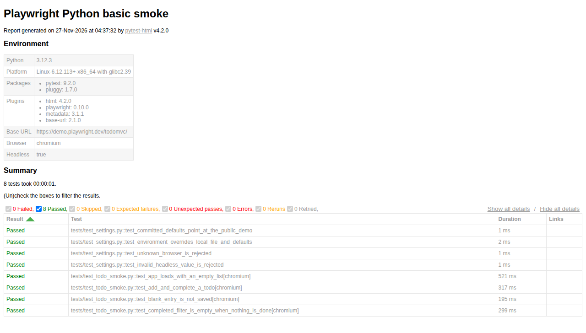

# Playwright Python Basic Smoke

[](https://github.com/Potucky/1-behave-selenium-login/actions/workflows/ci.yml)

**[Live test report](https://potucky.github.io/playwright-python-basic-smoke/)**

Introductory UI smoke suite for the public [TodoMVC demo](https://demo.playwright.dev/todomvc/). Tests are written in Python with pytest and the Playwright Python API.

This is a portfolio demo, not employer code. It is a basic, introductory smoke suite, not a deep Playwright framework.

## What this project demonstrates

- **Smoke checks on a UI build.** The suite opens the app, checks the title and heading, adds a todo, and marks it complete.
- **Negative and empty-state checks.** A whitespace-only entry is not saved. The Completed filter is empty while the only todo is still active.
- **Failure evidence.** A screenshot is captured only when a test fails and is embedded in the HTML report. The run also writes JUnit XML for CI.
- **Configuration without editing tests.** Base URL, browser, and headless mode come from `config/settings.env` or from environment variables.
- **A CI gate and a published report.** GitHub Actions runs the suite on push and on pull request, uploads the HTML and JUnit reports, and publishes the HTML report from `main` to GitHub Pages.

## Tech stack

- Python 3.12 (3.10 or newer; CI uses 3.12)
- pytest and pytest-playwright
- Playwright Python API, with Chromium in CI
- pytest-html for a self-contained HTML report
- GitHub Actions

## Project structure

```text
├── .github/workflows/ci.yml      # runs the suite on push and pull request
├── .github/workflows/pages.yml   # on main, publishes the HTML report
├── config/settings.env           # committed base URL, browser, headless
├── config/settings.py            # loads the file and environment overrides
├── conftest.py                   # applies that config to pytest-playwright
├── pages/todo_page.py            # locators for the demo page
├── tests/test_todo_smoke.py      # load, happy path, blank input, empty filter
├── tests/test_settings.py        # config precedence, no browser
├── site/index.html               # page that links to the published report
├── docs/test-report.png          # screenshot of a local HTML report
├── pytest.ini
└── requirements.txt              # pinned versions
```

## How to run locally

Python 3.12 is what CI uses. Create a virtual environment, install the pinned dependencies, install Chromium, and run pytest:

```bash
python3 -m venv .venv
source .venv/bin/activate
python -m pip install -r requirements.txt
python -m playwright install chromium
python -m pytest
```

On Windows, activate the environment with `.venv\Scripts\activate`.

After a run, open `reports/report.html`. The same command writes `reports/junit.xml`.

To watch the browser, use a machine with a display:

```bash
HEADLESS=false python -m pytest --headed
```

## Configuration

| Variable | Default | What it sets |
| --- | --- | --- |
| `BASE_URL` | `https://demo.playwright.dev/todomvc/` | Page the smoke suite opens |
| `BROWSER` | `chromium` | `chromium`, `firefox`, or `webkit` |
| `HEADLESS` | `true` | `false` needs a display |

`config/settings.local.env` overrides the committed file and is gitignored. Environment variables override both. A command-line `--base-url` or `--browser` overrides the file and the environment for that one run. `--headed` forces a visible browser.

CI installs Chromium only. To run another browser locally, install it first, for example `python -m playwright install firefox`, then `BROWSER=firefox python -m pytest`.

## Test report



The image is the pytest-html report from a local headless run of this suite.

GitHub Actions uploads `reports/report.html` and `reports/junit.xml` as the `test-report` artifact on every CI run, including failed runs.

The [live test report](https://potucky.github.io/playwright-python-basic-smoke/) is published by `.github/workflows/pages.yml` on push to `main`. The site is `index.html` plus the HTML report. That URL matches the repository name `playwright-python-basic-smoke`. In the repository settings, Pages has to use **Source: GitHub Actions** before the first deploy can succeed. The Pages workflow can also be started by hand from the Actions tab.

## Test approach

- Each UI test gets a new browser context. An init script clears the demo's `localStorage` before the app reads it, so a test does not depend on todos left behind by an earlier test.
- Checks use Playwright's auto-waiting `expect`. The suite does not call `time.sleep`. The 15 second assertion timeout and the 20 second navigation timeout are limits on how long a check may wait before it fails.
- Screenshots are taken only after a failure, then embedded in the self-contained HTML report.
- The app under test is a public practice site. This repository has no accounts, passwords, or tokens.
- CI runs headless Chromium.

## Author

Vasyl Popovich, QA Automation Engineer, Miami, FL. GitHub: https://github.com/Potucky
